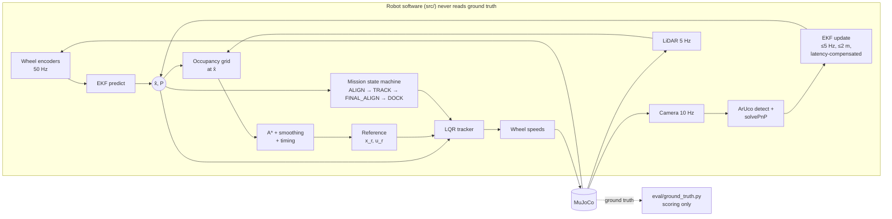
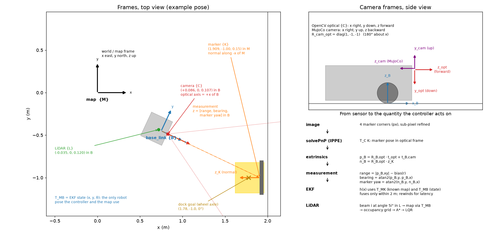
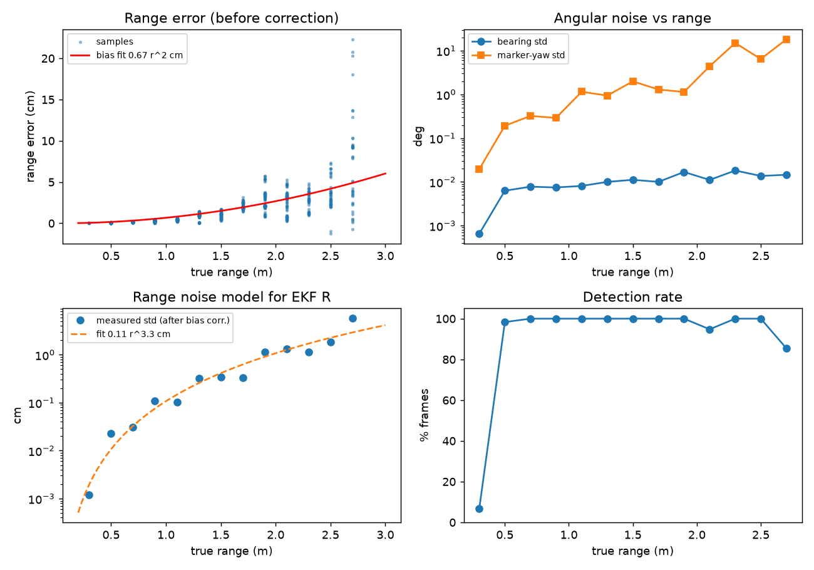
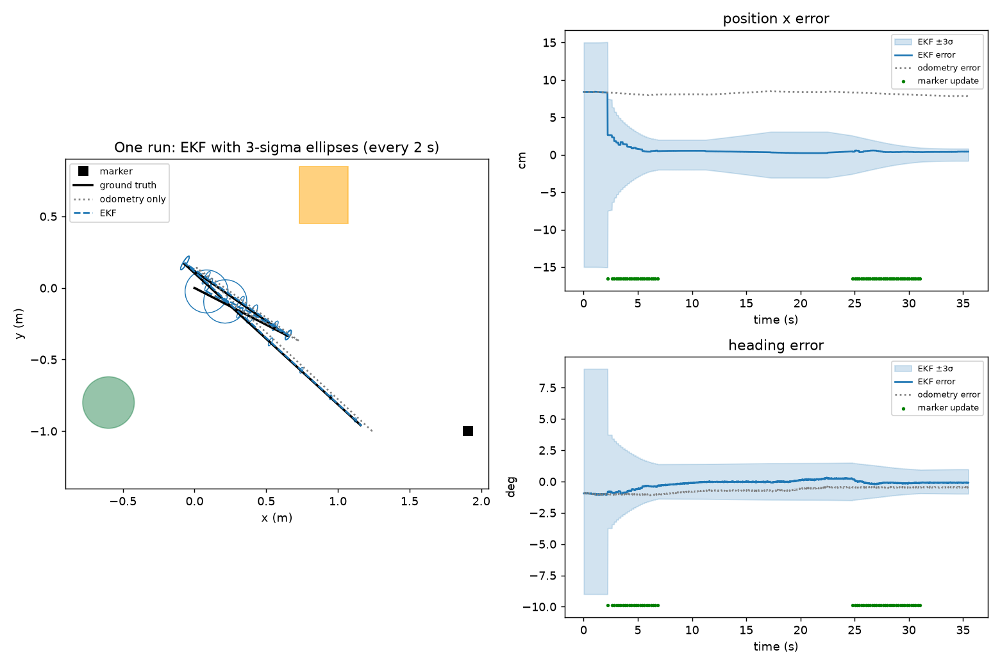
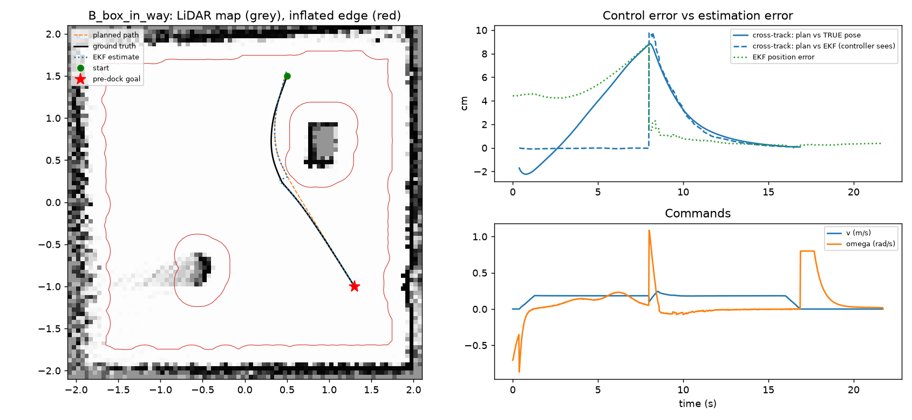

# Track A: TurtleBot3 Visual Waypoint Navigation and Docking

**UTS 41014 Sensors and Control in Mechatronics Systems: Integrated Project, Group 15**

A TurtleBot3 Waffle Pi in MuJoCo crosses a room it has never seen, builds a LiDAR map, plans around the obstacles, and docks on an ArUco-marked charging pad. It knows where it is from an **EKF that fuses wheel odometry with camera pose measurements of the marker**, and it is steered by an **LQR trajectory tracker that only ever sees the EKF estimate**. Simulator ground truth is used only to score the runs.

| | |
|---|---|
| **Track** | A, mobile robot: visual waypoint navigation |
| **Team** | Group 15: *add names and student IDs* (see [Individual contributions](#individual-contributions)) |
| **Code** | <https://github.com/Rusa05/Integrated-Project---Sensors-and-Control---group15> |
| **Demo video (5 min)** | *add link* |


## Results at a glance

| What | Result | Where |
|---|---|---|
| Full mission, fixed scenarios | **9 / 9 docked**, 0.58 cm and 0.15° from the dock goal | [Part E](part_E_integration_and_robustness/) |
| Robustness: random layouts × pushes, slip, occlusion, camera latency, 2× noise, all combined | **80 / 80 docked**, worst 0.99 cm | [Part E](part_E_integration_and_robustness/) |
| EKF vs wheel odometry alone (20 Monte Carlo runs) | **2.2 cm vs 8.1 cm** RMS; final 0.43 cm vs 9.0 cm; truth inside 3σ 100 % of the time | [Part C](part_C_estimation/) |
| EKF consistency | Average NEES 2.3 (95 % bounds 2.0–4.2) | [Part C](part_C_estimation/) |
| Path tracking | 1.6 cm RMS cross-track against the estimate; 9 / 9 around obstacles without contact | [Part D](part_D_control/) |
| Failures found and fixed | 4, each traced to estimation or planning (below) | [Part E](part_E_integration_and_robustness/) |

## Contents

1. [Quick start](#quick-start)
2. [System overview](#system-overview)
3. [Part A: Modelling](#part-a-modelling)
4. [Part B: Sensing, calibration and frames](#part-b-sensing-calibration-and-frames)
5. [Part C: Estimation (EKF)](#part-c-estimation-ekf)
6. [Part D: Planning and control](#part-d-planning-and-control)
7. [Part E: Integration and robustness](#part-e-integration-and-robustness)
8. [Limitations](#limitations)
9. [Repository layout and reproducing every result](#repository-layout-and-reproducing-every-result)
10. [Individual contributions](#individual-contributions)
11. [Generative AI declaration](#generative-ai-declaration)
12. [Sources and acknowledgements](#sources-and-acknowledgements)

---

## Quick start

Python 3.10+ (developed on 3.12, MuJoCo 3.15).

```bash
git clone https://github.com/Rusa05/Integrated-Project---Sensors-and-Control---group15.git
cd Integrated-Project---Sensors-and-Control---group15
python -m pip install -r requirements.txt
```

Watch a full mission (on macOS use `mjpython` instead of `python` for anything that opens a viewer):

```bash
python part_E_integration_and_robustness/run_mission.py --viewer
```

Other entry points (all run from the repository root):

| Command | What it does | Time |
|---|---|---|
| `python part_A_modelling/turtlebot_sim.py` | Drive the robot yourself (W/A/S/D, C = camera view) | n/a |
| `python part_E_integration_and_robustness/run_mission.py --record mission.mp4` | Record a full mission with overlays | ~1 min |
| `python part_E_integration_and_robustness/run_mission.py --scenario B_box_in_way --viewer` | Other start positions: `A_cylinder_in_way`, `B_box_in_way`, `C_far_corner`, or `--start X Y THETA` | n/a |
| `python part_E_integration_and_robustness/run_trials.py --record disturbed.mp4 --only combined --trial 7` | Record a disturbed run (push, slip, occlusion, latency) | ~1 min |
| `python part_E_integration_and_robustness/run_trials.py --trials 3` | Quick robustness batch | ~3 min |

Every result on this page has its own script; see [Reproducing every result](#repository-layout-and-reproducing-every-result).

---

## System overview



**Ground-truth rule.** The robot's software is everything in [`src/`](src/). It reads only sensor channels: encoders, rangefinders and the rendered camera image. The simulator's true pose is read in exactly one file, [`eval/ground_truth.py`](eval/ground_truth.py), which the test scripts use to place the robot, score runs and diagnose failures. You can check this with:

```bash
grep -rn "ground_truth\|qpos" src/
```

It returns nothing.

**Mission states** ([`src/mission.py`](src/mission.py)):

1. **ALIGN:** turn on the spot to the path heading.
2. **TRACK:** LQR along the A* path, replanning if the path becomes blocked.
3. **FINAL_ALIGN:** face the marker from the pre-dock pose, 0.6 m out.
4. **DOCK:** LQR along a curve that ends on the dock axis.
5. **DOCKED.**

---

## Part A: Modelling

Folder: [`part_A_modelling/`](part_A_modelling/) (steps A1–A4).

### Platform

The official ROBOTIS TurtleBot3 Waffle Pi model, with real meshes, masses and limits, plus the sensors we added: camera, 72-beam LiDAR and encoders.

- Wheel radius r = 0.033 m, wheel separation b = 0.288 m, mass 1.86 kg.
- Wheel limit 7.88 rad/s, which gives 0.26 m/s.

We found and fixed three problems in the official model's contact and actuator settings. Together they made the robot slip 11 % driving straight and 24 % turning. Each fix is reproducible with `part_A_modelling/official_model_checks.py`:

| Change | Why | Straight / turn, true ÷ odometry |
|---|---|---|
| Official model | n/a | 0.888 / 0.763 |
| Chassis collision mesh → box raised 1 cm | The mesh touched the floor and carried 35 % of the weight | 0.890 / 0.765 |
| Caster contact priority | MuJoCo takes the *higher* friction of two touching surfaces, so the "frictionless" casters dragged | 0.999 / 0.998 |
| Wheel servo gain kv 0.1 → 1.0 | Wheels reached only 49–75 % of the commanded speed; the real XL430 has its own velocity loop | 0.997 / 1.000 |

### State-space model

State **x** = [x, y, θ] (pose of `base_link` in the map frame); input **u** = [v, ω].

```
ẋ = v cos θ        v = r(ω_R + ω_L)/2
ẏ = v sin θ        ω = r(ω_R − ω_L)/b
θ̇ = ω
```

**Assumptions:** flat floor, rigid body, no lateral slip. Motor dynamics are ignored, because the measured wheel time constant is 14 ms against the 20 ms control period. The model is discretised at 50 Hz with a midpoint rule; the Jacobians are in [`src/model.py`](src/model.py).

For control, the tracking error **e** (reference relative to the robot, in the robot frame) is linearised about the reference (v_r, ω_r):

```
ė = A e + B u_fb,   A = [[0, ω_r, 0], [−ω_r, 0, v_r], [0, 0, 0]],   B = −[[1,0],[0,0],[0,1]]
```

### Controllability and observability

| Question | Rank | Consequence in the design |
|---|---|---|
| Tracking error, reference moving (v_r or ω_r ≠ 0) | **3 / 3** | LQR can correct any error |
| Tracking error, reference at rest | 2 / 3 | Can't correct sideways error standing still (non-holonomic). So the robot turns on the spot *before* tracking, and docking uses a moving reference |
| Odometry only | 0 / 3 | Absolute pose unobservable: drifts forever |
| Range + bearing to one marker, even while moving | **2 / 3** | Rotating the whole path about the marker gives identical readings |
| Range + bearing + **marker yaw** | **3 / 3** | The EKF uses this pose measurement |

The rank-2 result for range + bearing came back in the robustness trials as a real failure. Range + bearing updates from beyond 2 m, where the yaw isn't usable, moved the estimate the wrong way. See [Part E](#part-e-integration-and-robustness).

---

## Part B: Sensing, calibration and frames

Folder: [`part_B_sensing/`](part_B_sensing/) (steps B1–B4).



### Frames

| Transform | Value | Source |
|---|---|---|
| map → base_link (T_MB) | EKF state (x, y, θ) | estimated |
| base_link → LiDAR | (−0.035, 0, 0.120) m | robot model |
| base_link → camera | (0.086, 0, 0.107) m, looking along +x of B | robot model |
| MuJoCo camera → OpenCV optical | diag(1, −1, −1) (180° about x) | convention |
| map → marker (T_MK) | (1.9085, −1.0, 0.15) m, normal along −x | known map ([`src/config.py`](src/config.py)) |

### Calibration

- **Intrinsics:** taken from the simulated camera's field of view (Pi Camera v2, 48.8° vertical, 640×480): f = H / (2 tan(fovy/2)), principal point at the image centre.
- **Range bias:** detected corners sit slightly inside the true marker edge, so measured range reads long by **0.0067·r² m** (1.5 cm at 1.5 m). The bias is fitted over 1224 frames and subtracted.

### Sensor noise models

All sensors in MuJoCo are perfect, so we add noise modelled on the real hardware ([`src/sensors.py`](src/sensors.py)):

| Sensor | Model | Source |
|---|---|---|
| Encoders | 4096 ticks/rev quantisation + 0.002 rad jitter | Dynamixel XL430 |
| LiDAR | σ = max(7.5 mm, 2.5 % of range), 0.12–3.5 m, 1 % dropout | LDS-01 datasheet |
| Camera | 10 Hz, 640×480, pixel noise σ = 3 grey levels | Pi Camera v2 |

### Measured marker accuracy (1224 frames over 0.3–2.7 m, `part_B_sensing/results/marker_noise.png`)

| Quantity | Result |
|---|---|
| Detection | 98–100 % from 0.5 to 2.5 m; drops beyond; 7 % at 0.3 m (leaves the field of view) |
| Range noise (after bias correction) | σ = 1.1 mm · r^3.3 |
| Bearing noise | σ = 0.007° · r^1.1 |
| Marker-yaw noise | σ = 0.63° · r^2.7; 1.8 % of frames flip by more than 20° (IPPE ambiguity) |



---

## Part C: Estimation (EKF)

Folder: [`part_C_estimation/`](part_C_estimation/). Code: [`src/ekf.py`](src/ekf.py).

### Design

| Step | Rate | What happens |
|---|---|---|
| **Predict** | 50 Hz | Unicycle model driven by encoder increments. Q is built from wheel slip (1 % of wheel travel) and pushed through the Jacobian to x, y, θ |
| **Update** | ≤ 5 Hz | z = [range, bearing, marker yaw]. Falls back to range + bearing if the yaw fails the gate |
| Gate | each update | χ² test, 99 % (3 dof: 11.3; 2 dof: 9.2) |
| Range limit | each update | Readings beyond **2 m** are ignored |
| Lock-out recovery | after 5 rejections in a row | Inflate P on each further rejection |
| Latency compensation | late frames | Rewind to the capture time, update there, replay odometry |

### Parameter values and why

| Parameter | Value | Why |
|---|---|---|
| Q | slip σ = 1 % of wheel travel | Measured drift is 0.35 %. NEES tests: 0.5 % over-confident, 2 % pessimistic |
| Encoder rounding in Q | **left out** | Errors on an *absolute* angle cancel between increments; including them made the filter far too pessimistic |
| R (range, bearing, yaw) | Part B fits, floors 2 cm / 0.5° / 2° | Floors cover the camera's systematic, frame-to-frame-repeating error. A 1 cm range floor gave peak NEES 17.8; 2 cm gave 6.5 |
| Update rate | 5 Hz (of 10 Hz frames) | Consecutive frames repeat the same error; fusing them all counts it twice |
| Range limit | 2 m | Beyond the yaw's useful range, range + bearing alone can't fix heading, and far updates made the estimate worse |
| P0 | (5 cm, 5 cm, 3°)² | Uncertainty of placing the robot at the start |

### Results (20 Monte Carlo runs, a drive that loses the marker for 15 s)

| | EKF | Odometry only |
|---|---|---|
| Position RMSE | **2.2 cm** | 8.1 cm |
| Heading RMSE | **0.77°** | 2.6° |
| Final position error | **0.43 cm** | 9.0 cm |
| Truth inside ±3σ | **100 %** | n/a |
| Average NEES (ideal 3, bounds 2.0–4.2) | **2.3** | n/a |



**What if R were 10× smaller or larger?**

| R scale | Position RMSE | NEES |
|---|---|---|
| ×0.1 | 1.89 cm | **8.0**: over-confident, and the gate rejects good readings |
| **×1** | **1.94 cm** | **2.3**: consistent |
| ×10 | 3.11 cm | 1.6: pessimistic, slow to correct |

Trusting the camera more gains no accuracy, but makes the filter believe it is three times more certain than it is. That matters because the gate, planner and docking logic all rely on P.

---

## Part D: Planning and control

Folder: [`part_D_control/`](part_D_control/). Code: [`src/mapping.py`](src/mapping.py), [`src/planner.py`](src/planner.py), [`src/controller.py`](src/controller.py).

### Map and planner

- **Map:** log-odds occupancy grid, 5 cm cells, built online from LiDAR at the EKF pose. Nothing about the room is known in advance.
- **Planner:** A* with **0.25 m inflation**, which is the circle containing the Waffle Pi footprint around its axle, plus a 0.2 m soft-cost margin. Then line-of-sight shortcuts and smoothing.
- **Timing:** cruise 0.18 m/s, lateral acceleration ≤ 0.15 m/s², acceleration ≤ 0.2 m/s², wheel-speed limits. Heading and curvature come from a 41 cm Savitzky-Golay derivative, which removed a grid-induced turn-rate wobble.

### LQR tracker

- Discrete-time LQR on the linearised tracking error, gain-scheduled on the reference speed: u = [v_r cos e₃, ω_r] − K e, then wheel saturation that preserves curvature.
- **Weights by Bryson's rule:** Q = diag(1/0.05², 1/0.05², 1/0.15²), meaning 5 cm along-track, 5 cm cross-track, 0.15 rad heading. R = diag(1/0.10², 1/0.8²), meaning 0.1 m/s and 0.8 rad/s of correction.
- At v_r = ω_r = 0 the Riccati equation has no stabilising solution (rank 2), so the gain uses a slow crawl speed and the mission turns on the spot first.

### Docking

- Approach from the pre-dock pose, 0.6 m in front of the marker, at 0.06 m/s along a **cubic Hermite curve ending on the dock axis**, tracked by the same LQR.
- The marker corrects the EKF until it leaves the camera view, about 0.30 m out. The final ~0.17 m runs on odometry.
- A **LiDAR backstop** stops the robot if the backplate reads closer than 0.13 m (0.165 m expected at the dock). It was never triggered.

### Results

| Test | Result |
|---|---|
| Navigate to pre-dock, 3 scenarios × 3 seeds | 9 / 9, no contact; final 0.65 cm / 0.6° |
| Cross-track error vs **estimate** (controller's view) | 1.6 cm RMS |
| Cross-track error vs **truth** | 4.7 cm RMS: mostly EKF error before the marker is within 2 m |
| Full mission with docking, 9 runs | **9 / 9 docked, 0.58 cm, 0.15°** (2 cm / 3° tolerance) |



**Control effort vs tracking error** (LQR R ×0.1 / ×1 / ×10):

| R scale | Feedback turn effort | Cross-track error vs truth |
|---|---|---|
| ×0.1 | 0.144 rad/s | 5.03 cm |
| **×1** | **0.096 rad/s** | **5.13 cm** |
| ×10 | 0.062 rad/s | 5.23 cm |

The trade-off curve is flat: +50 % effort buys −2 % error. The remaining error is estimation error, which no control gain can remove, so the chosen weights sit at the knee.

---

## Part E: Integration and robustness

Folder: [`part_E_integration_and_robustness/`](part_E_integration_and_robustness/) (E1 full mission, E2 trials).

### Trials

Every trial has a random start pose, random obstacle positions and rotation, and a random initial-estimate error. Ten trials per condition, 80 in total.

| Condition | Docked (2 cm / 3°) | Dock error mean / worst |
|---|---|---|
| Nominal | **10 / 10** | 0.53 / 0.69 cm |
| Push: 8 N for 0.2 s, random time and direction | **10 / 10** | 0.52 / 0.63 cm |
| Slip: tyre friction 1.0 → 0.1 | **10 / 10** | 0.52 / 0.65 cm |
| Marker occluded for 10 s | **10 / 10** | 0.61 / 0.99 cm |
| Camera latency 0.2 s | **10 / 10** | 0.57 / 0.64 cm |
| Latency 0.2 s, compensation off | 10 / 10 | 0.61 / 1.24 cm |
| All sensor noise ×2 | **10 / 10** | 0.56 / 0.63 cm |
| Combined: push + slip + occlusion + 0.1 s latency | **10 / 10** | 0.57 / 0.86 cm |


### Failures diagnosed and fixed

The first full batch docked 59 / 70 (1 / 10 with uncompensated latency). Each failure was classified automatically:

- **Collision:** was the EKF more than 8 cm off at the moment of contact?
- **Docking miss:** was the EKF's position or heading off at the dock?

Failing runs were then replayed with a full filter log.

| Failure | Root cause | Part | Fix |
|---|---|---|---|
| Latency: "docked" 6–44 cm off, confident | Measurements fused as if current; at 0.8 rad/s, 0.2 s is about 9° | Estimation | Timestamped frames; EKF rewinds 1 s of history and replays (unit-tested to match exactly) |
| Noise ×2: 16 cm off | Accepted range + bearing updates at 2.6–2.8 m each *increased* the error (5 → 19 cm): without yaw, one marker can't fix heading (rank 2) | Estimation | Fuse the marker only within 2 m |
| Occlusion: 49 cm off | **Gate lock-out:** a large initial error made every reading fail the gate, so the filter never corrected | Estimation | After 5 rejections in a row, inflate P until readings pass |
| Six runs: right place, 3.5–8.6° crooked | Docking path was a straight line from wherever the robot stopped | Planning | Hermite curve ending on the dock axis (now 0.15°) |

**Trade-off of the 2 m range limit:** the robot now waits longer for its first marker correction. Mid-route EKF error during navigation rose from 4.1 to 5.8 cm RMS, but divergence failures disappeared, and final docking accuracy is unchanged.

---

## Limitations

What these results do and don't support:

- **Sample size.** 10/10 per condition bounds the true success rate above about 69 % (95 % confidence) for that condition; 80/80 overall, above about 95 %.
- **Simulation only.** The camera has no lens distortion, blur or rolling shutter, and the measured bearing noise (0.007°) is unrealistically small. That is why R has floors. On hardware, R would need re-measuring.
- **One marker.** The pose is observable only through the marker-yaw measurement, which degrades past 1.5–2 m. Before the robot is within 2 m, it runs on odometry with its initial uncertainty. A second landmark, or LiDAR scan matching against the walls, would remove this.
- **Static world.** The replanning and LiDAR safety stop were implemented but never triggered in 80 trials; moving obstacles were not tested.
- **The final ~0.17 m of docking is blind** (the marker leaves the camera view). It relies on odometry, which is accurate over that distance (< 1 mm drift), but a larger disturbance in that stretch wouldn't be seen.
- **Recovery has limits.** Pushes larger than those tested ("kidnapping") are not recoverable without a marker search behaviour.

---

## Repository layout and reproducing every result

The repository is organised by the marking guide's parts. Each part folder has a README that opens with what the guide asks for, then the steps in order, the design choices with their values, and the results.

| Folder | Marking part | Steps | Reproduce with | Time |
|---|---|---|---|---|
| [`part_A_modelling/`](part_A_modelling/) | **A** Modelling | A1 drive the robot · A2 open-loop test · A3 official-model fixes · A4 controllability/observability, actuator, odometry | `python part_A_modelling/official_model_checks.py`<br>`python part_A_modelling/model_analysis.py` | 40 s |
| [`part_B_sensing/`](part_B_sensing/) | **B** Sensing | B1 marker · B2 detection check · B3 frame diagram · B4 noise and calibration | `python part_B_sensing/check_dock_marker.py`<br>`python part_B_sensing/frame_diagram.py`<br>`python part_B_sensing/sensor_noise.py` | 1 min |
| [`part_C_estimation/`](part_C_estimation/) | **C** Estimation | EKF Monte Carlo, NEES/NIS, R study | `python part_C_estimation/run_ekf_test.py` | 15 min |
| [`part_D_control/`](part_D_control/) | **D** Control | D1 navigation + LQR trade-off · D2 docking controller | `python part_D_control/run_navigation.py` | 4 min |
| [`part_E_integration_and_robustness/`](part_E_integration_and_robustness/) | **E** Integration and robustness | E1 full mission + video · E2 80 disturbed trials | `python part_E_integration_and_robustness/run_mission.py`<br>`python part_E_integration_and_robustness/run_trials.py` | 4 + 7 min |
| [`deliverables/`](deliverables/) | Section 3 checklist | Submission checklist, 5-minute video plan | n/a | n/a |

Shared code, used by every part:

| Folder | Contents |
|---|---|
| [`src/`](src/) | The robot's software: `model`, `sensors`, `vision`, `ekf`, `mapping`, `planner`, `controller`, `mission`, `robot`, `config`. **Never reads ground truth** |
| [`eval/`](eval/) | `ground_truth.py`: the only file that reads the true pose (scoring only) |
| [`turtlebot3/`](turtlebot3/) | MuJoCo world and robot (official ROBOTIS model + Track A changes) |

Random seeds are fixed, so each script reproduces the numbers on this page.

---

## Individual contributions

> *To be completed by the team. Each member writes their own row: what they designed, implemented, tested and wrote, with the files and phases. Viva questions cover your own part and at least one part you didn't lead.*

| Member (student ID) | Main contributions | Files / phases |
|---|---|---|
| *name (ID)* | | |
| *name (ID)* | | |
| *name (ID)* | | |
| *name (ID)* | | |

---

## Generative AI declaration

> *Review and edit so it matches how each member actually used these tools.*

| Tool | Used for |
|---|---|
| **ChatGPT** (OpenAI) | Setup troubleshooting, early project planning, and adapting the initial movement-test script (`part_A_modelling/open_loop_test.py`) |
| **Codex** (OpenAI) | Generating the original primitive-shape starter robot and the keyboard-driving script (`part_A_modelling/turtlebot_sim.py`, since adapted to the Waffle Pi) |
| **Claude** (Anthropic, via Claude Code) | Project planning document; writing and debugging code for Parts A–E (marker and scene, model checks, sensor noise, vision, EKF, mapping, planner, LQR, mission, trials, video recorder); diagnosing the official model's slip and the robustness-trial failures; drafting READMEs and this page |

All results on this page come from running the code in this repository. The team is responsible for checking, understanding and being able to explain every part of it in the viva.

---

## Sources and acknowledgements

- **Robot model:** [ROBOTIS mujoco menagerie](https://github.com/ROBOTIS-GIT/robotis_mujoco_menagerie), TurtleBot3 Waffle Pi, Apache-2.0 ([`turtlebot3/LICENSE_ROBOTIS.txt`](turtlebot3/LICENSE_ROBOTIS.txt)). The unmodified file is kept as `turtlebot3/turtlebot3_waffle_pi_official.xml`; our changes are marked `TRACK A` in `turtlebot3/turtlebot3_waffle_pi_track_a.xml`.
- **Simulation loop:** structure adapted from the supplied UR3 tutorial (`move_ur3e.py`).
- **Libraries:** [MuJoCo](https://mujoco.org), [OpenCV](https://opencv.org) (ArUco detection, IPPE solvePnP), NumPy, SciPy (Riccati solver, distance transform, Savitzky-Golay), Matplotlib.
- **Hardware figures:** ROBOTIS LDS-01 and Dynamixel XL430 datasheets; Raspberry Pi Camera v2 field of view.
- **Methods:**
  - EKF consistency tests (NEES/NIS): Bar-Shalom, Li and Kirubarajan, *Estimation with Applications to Tracking and Navigation* (2001).
  - Tracking-error model: Kanayama et al., "A stable tracking control method for an autonomous mobile robot" (ICRA 1990).
  - LQR weights by Bryson's rule.
