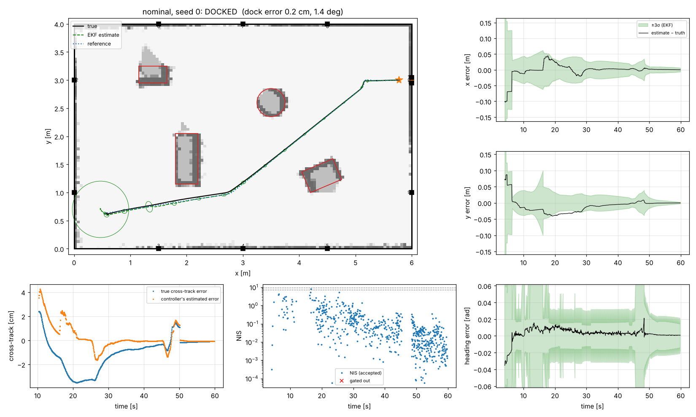
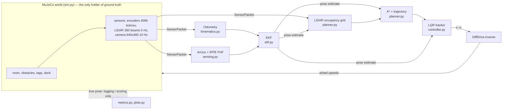
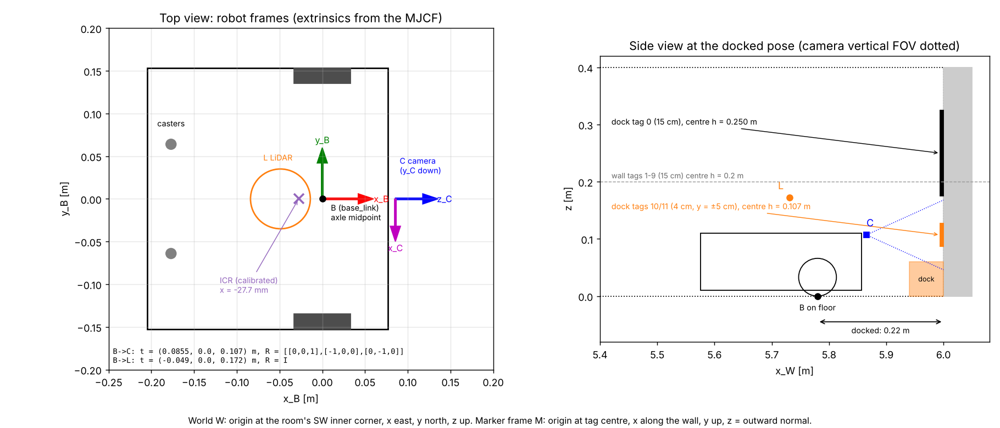
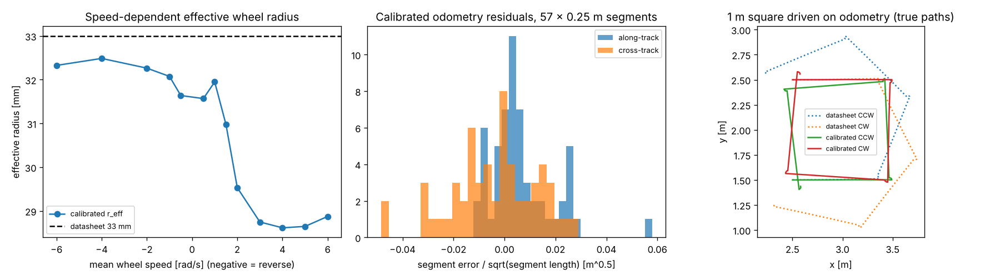
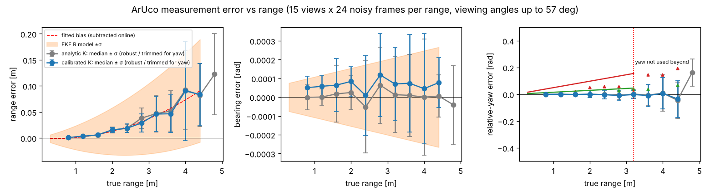
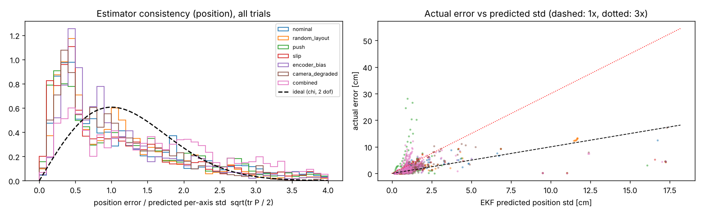
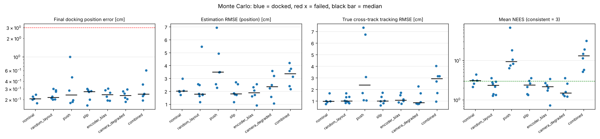
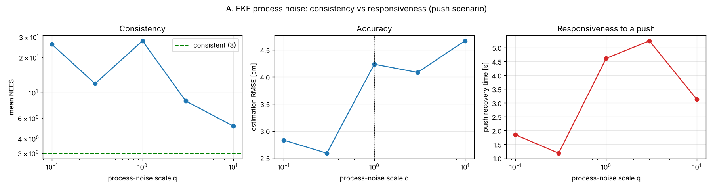
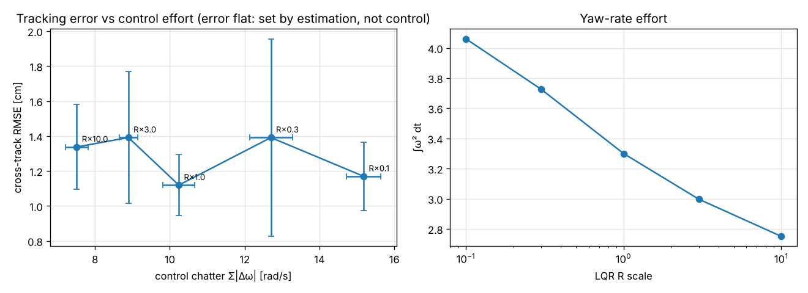

# Track A — TurtleBot3 visual waypoint navigation and docking

**UTS 41014 Sensors and Control for Mechatronic Systems — Integrated Project**

| | |
|---|---|
| **Group** | 15 *(confirm)* |
| **Members** | *Name 1 (ID)*, *Name 2 (ID)*, *Name 3 (ID)*, *Name 4 (ID)* |
| **Track** | A — mobile robot: visual waypoint navigation (TurtleBot3 Waffle Pi, 2D LiDAR + camera, MuJoCo) |
| **Repository** | https://github.com/Rusa05/Integrated-Project---Sensors-and-Control---group15 (branch `Claudia`) |
| **Demo video (5 min)** | *add link* — raw clips: `results/runs/demo_nominal.mp4`, `demo_push.mp4` (regenerate with `--record`) |

A TurtleBot3 starts at an unknown pose in a 6 × 4 m room with obstacles it has never seen.
It localises from ArUco tags, maps the obstacles with its LiDAR, plans and tracks a path with
an LQR controller and docks at an ArUco-marked charging station. **The controller only ever
sees the EKF estimate;** the simulator's true pose is used for logging and scoring only.

<p align="center"></p>

> **New to the repo?** [`docs/step_by_step.md`](docs/step_by_step.md) walks through every step,
> the reasoning behind it, the video plan and viva preparation.

---

## 1. Quick start

```bash
python3 -m venv .venv && source .venv/bin/activate      # Windows: .venv\Scripts\activate
pip install -r requirements.txt
python scripts/04_run_mission.py                         # one mission -> results/runs/nominal_seed0.png
mjpython scripts/04_run_mission.py --viewer              # macOS live 3D view (python on Linux/Windows)
python scripts/04_run_mission.py --scenario push --seed 0 --record results/runs/push.mp4
```

Headless Linux: `export MUJOCO_GL=egl` (or `osmesa`) first. The calibration results the
pipeline needs are committed in `results/calibration.json`. To reproduce everything from
scratch, run the scripts in order:

| Step | Command | Produces |
|---|---|---|
| 0 | `python scripts/00_frame_diagram.py` | frame diagram |
| 1 | `python scripts/01_model_analysis.py` | actuator ID, model validation, controllability / observability |
| 2 | `python scripts/02_calibrate_odometry.py` | odometry model → `results/calibration.json` |
| 3 | `python scripts/03_calibrate_camera.py` | camera K, ArUco noise model → `results/calibration.json` |
| 4 | `python scripts/04_run_mission.py [--scenario S --seed k --viewer --record f.mp4]` | one run + figure |
| 5 | `python scripts/05_monte_carlo.py --workers N` | `results/monte_carlo.md`, `figures/mc_*.png` |
| 6 | `python scripts/06_tradeoffs.py --workers N` | `results/tradeoffs.md`, `figures/tradeoff_*.png` |

## 2. System overview



Mission state machine (`mission.py`): `LOCALISE → PLAN → ALIGN → TRACK → DOCK_ALIGN → DOCK → DONE`,
with replanning when new LiDAR obstacles block the path, on a LiDAR safety stop or on a large
tracking error. A divergence detector re-localises after 6 consecutive rejected camera updates
(for example after a push).

**Ground truth is evaluation-only and this is visible in the code:** `Simulator.ground_truth_for_evaluation()`
is called only by the logger in `run_mission`, the video overlay and the offline calibration
scripts (`grep -n ground_truth tb3nav/*.py scripts/*.py`). The `Robot` class receives only
`SensorPacket`s.

## 3. Modelling (Part A)

Derivation and analysis: `tb3nav/model.py`, `scripts/01_model_analysis.py`, results in
`results/model_analysis.json`.

**Full model** (5 states, wheel-speed set-points as inputs):

$$\dot x = \tfrac{r}{2}(\omega_L+\omega_R)\cos\theta,\quad \dot y = \tfrac{r}{2}(\omega_L+\omega_R)\sin\theta,\quad \dot\theta = \tfrac{r}{b}(\omega_R-\omega_L),\quad \dot\omega_i = (\omega_{i,cmd}-\omega_i)/\tau$$

* **τ identified at 7.1 ms** from wheel step responses (static gain ≈ 1.01). Because τ is far
  below the 50 ms control period, the estimator and controller use the reduced unicycle model
  `s = [x, y, θ]`, `u = [v, ω]`.
* **Platform-specific kinematics** (from calibration, §4): speed-dependent effective radius
  `r_eff(ω̄)`, speed-dependent turn gain `g(ω̄)`, and the robot turns about an ICR **27.7 mm behind
  the axle**, so `base_link` moves sideways by `−x_ICR·Δθ` on the spot. Open-loop validation
  against MuJoCo: 5.3 cm position and 5.8° heading drift after 10 s of open-loop driving on encoders alone.
* **Assumptions stated:** planar motion; rigid body; wheel dynamics much faster than the outer loop
  (checked); the slip is captured in the calibrated tables plus process noise; the actuator
  gain `kv` was raised from 0.1 to 1.0 to emulate a Dynamixel in velocity mode (the menagerie
  value gave a ~2 rad/s dead band against 0.1 N·m joint friction).

**Tracking-error model** for the LQR (robot frame, about the reference `v_r, ω_r`):

$$\dot e = \begin{bmatrix}0&\omega_r&0\\-\omega_r&0&v_r\\0&0&0\end{bmatrix}e+\begin{bmatrix}1&0\\0&0\\0&1\end{bmatrix}u,\qquad v=v_r\cos e_\theta-u_1,\ \ \omega=\omega_r-u_2$$

**Controllability.** The error model has rank 3 for `v_r ≠ 0` or `ω_r ≠ 0` and rank 2 at
`v_r = ω_r = 0`. The unicycle linearised at standstill has rank 2 (Brockett: no smooth static
feedback stabilises a point). Hence on-the-spot turns use a separate heading controller, and the
gain schedule clamps `v_r ≥ 1 cm/s`. The full 5-state model is rank 5 when moving and rank 4 at
standstill.

**Observability** (rank of the observability Gramian over 5 s, `figures/model_analysis.png`):

| Sensors | Stationary | Driving |
|---|---|---|
| odometry only | 0 / 3 | 0 / 3 |
| one tag, range + bearing | 2 / 3 | **2 / 3** |
| one tag, range + bearing + tag yaw | 3 / 3 | 3 / 3 |
| two tags 10 cm apart, range + bearing | 3 / 3 | 3 / 3 |

With one point landmark, rotating the robot's whole pose about it changes neither range nor
bearing, so the pose is **not** observable even while moving. On the final docking approach the
tag yaw is unusable (head-on, §4), so the dock carries **two small tags 10 cm apart**. Before
this change the heading estimate drifted confidently while docking (docking-phase NEES ≈ 14);
after it the docking-phase NEES is ≈ 0.1–0.2.

## 4. Sensing, calibration and frames (Part B)

<p align="center"></p>

Frames (`tb3nav/frames.py`): **W** world; **B** `base_link` at the axle midpoint (the estimated and
controlled state); **C** camera optical frame (85.5 mm ahead, 107 mm up, OpenCV axes,
`R_BC = [[0,0,1],[−1,0,0],[0,−1,0]]`); **L** LiDAR (−49, 0, 172 mm); **M_i** tag frames. A camera
measurement goes pixel corners → IPPE PnP (`T_CM`) → `T_BM = T_BC·T_CM` → planar range, bearing and
relative yaw of the tag normal in **B**.

### 4.1 Odometry (`scripts/02_calibrate_odometry.py`)

<p align="center"></p>

| Quantity | Datasheet | Calibrated |
|---|---|---|
| wheel radius | 33.0 mm | 28.6 mm at cruise, 31.6–32.5 mm slow or reversing (table of 13 speeds) |
| turn gain r/b | 0.1146 | 0.0834 on the spot → 0.094 rolling (table) |
| ICR offset | 0 | −27.7 mm (IQR ±0.2 mm over 23 turns) |
| 1 m square on odometry, end error | 109–125 cm | 9.4–10.3 cm |
| odometry noise | — | k_s = 0.024 m^½ per wheel; rotation k_θ = 0.029 rad^½ |

The reference displacement in this offline calibration is the simulator's true pose, used as a tape
measure or overhead tracker would be on hardware.

### 4.2 Camera and ArUco measurement model (`scripts/03_calibrate_camera.py`)

<p align="center"></p>

* **Intrinsics:** 60 simulated checkerboard views with iterative outlier rejection (52 kept). The
  lens model was selected on **held-out** reprojection error: pinhole, no distortion, 0.059 px.
  Calibrated `fx = 529.11, fy = 529.08, cx = 319.53, cy = 239.68` against the analytic 529.08 / 319.5 /
  239.5. A naïve `calibrateCamera` (no initial guess, no outlier rejection) converged to a K with
  cx 17 px off, which caused a 0.03 rad bearing bias. This is a real failure we diagnosed.
* **Noise model** (15 ranges × 3 bearings × 5 viewing angles × 24 noisy frames):
  * range bias `c₁r + c₂r²` (≈ 4 cm at 3 m) is subtracted online; range σ = 0.7 mm + 2.2 % r;
  * bearing σ < 0.001 rad, floored at 0.005 rad in the EKF for unmodelled effects;
  * relative-yaw σ depends on the **viewing angle**: 0.048·r head-on against 0.014·r oblique. Yaw
    is used only while its σ < 0.08 rad;
  * **IPPE planar ambiguity:** both PnP solutions are kept and the EKF uses the one consistent
    with its prior. Gross flips (5–30 % of frames beyond 2.5 m) are rejected by the χ² gate;
  * tags of other sizes use the same model through pinhole similarity: `σ_s(r) = k·σ_ref(r/k)`,
    with `k = s/s_ref`.
* **Tag design:** 15 cm wall tags (usable to 4.4 m, so a tag is in range everywhere in the room)
  plus two 4 cm dock tags at camera height, which stay in view down to the docked pose.

### 4.3 LiDAR
LDS-01 model: 360 beams, 5 Hz, 0.12–3.5 m, σ = 5 mm (< 0.5 m) or 1.67 % of range, 1 % dropouts.
Scans are placed with the EKF pose into a 5 cm log-odds occupancy grid, which is inflated by
0.24 m (robot half-width 0.153 m plus a 9 cm margin) for planning. A forward-corridor check
gives a safety stop at 0.20 m.

## 5. Estimation (Part C)

`tb3nav/ekf.py`: EKF on `s = [x, y, θ]`.

* **Prediction** at 20 Hz from encoder ticks through the calibrated model (`r_eff`, `g`, ICR):
  `P⁺ = F P Fᵀ + G diag(σ_L², σ_R²) Gᵀ + Q_rot`, with `σ_i = k_s√|arc_i| + 0.1 mm` and
  `Q_rot = diag(k_xy², k_xy², k_θ²)·|Δθ|`. Full analytic Jacobians F and G.
* **Update** with each known tag: `z = [range, bearing, relative yaw]`. R is a function of range,
  tag size and viewing angle (§4.2). Joseph form. χ² gate at 99.7 %.
* **Initialisation without a prior:** two-tag triangulation from close tags (range + bearing
  only), or a single close, unambiguous tag pose. The robot spins in `LOCALISE` until the
  heading σ < 3° and the position σ < 3 cm.
* **Robustness:** adaptive covariance inflation when *two different* tags are rejected within
  0.5 s (genuine slip, not a single outlier). A divergence detector (6 consecutive rejections)
  triggers re-localisation and a map reset, which recovers from the push.

| Parameter | Value | Why |
|---|---|---|
| k_s | 0.024 m^½ | 1.2 × calibrated along-track odometry noise |
| k_θ, k_xy | 0.029 rad^½, 0.0065 m/rad^½ | 1.2 × calibrated in-place-turn residuals |
| R(range) | (0.7 mm + 2.2 % r)², floor 1 cm | calibrated (§4.2) |
| R(bearing) | floor (0.005 rad)² | calibrated σ < 0.001; floor covers motion and timing |
| R(yaw) | view-dependent, floor (0.03 rad)² | calibrated |
| gate | χ²(dof, 0.997) | rejects IPPE flips and mis-detections |

**Results** (from the 43-mission Monte Carlo in §7 and `figures/mc_consistency.png`):

* Estimation RMSE is **1.9–2.4 cm and 0.4–0.8°** in every condition without a push, including a
  slippery floor, a 4 % encoder-scale error and a degraded camera. In the docking phase it is
  ≈ 0.1 cm with σ ≈ 0.3 cm, thanks to the two dock tags.
* **Consistency.** The mean NEES is 1.9–3.1 against an ideal of 3 (nominal 3.09), so on average
  the filter's confidence is right. The *distribution* is not χ²: most samples sit well inside
  their predicted σ (conservative, mean NIS/dof ≈ 0.1 because of the R floors), while a few
  short excursions are over-confident (only 64–78 % of samples fall in the 95 % band). Those
  excursions occur on fast in-place turns and right after initialisation, where the
  linearisation is worst. This is the classic EKF inconsistency (Huang et al. 2008), so we
  report it rather than tune it away.

<p align="center"></p>

## 6. Control (Part D)

* **Planner** (`planner.py`): A* (8-connected, clearance cost) on the inflated LiDAR map → line-of-sight
  shortcutting → Laplacian smoothing (kept collision-free) → speed profile limited by
  `v_max = 0.15 m/s`, lateral acceleration 0.15 m/s², `|ω| ≤ 0.6 rad/s` and acceleration
  0.15 m/s² → time-parameterised reference `[x, y, θ, v, ω](t)`.
* **LQR tracker** (`controller.py`): discrete LQR on the ZOH-discretised error model at 20 Hz,
  **gain-scheduled** on `(v_r, ω_r)` (cached on a 1 cm/s × 0.02 rad/s grid). Bryson's rule:
  `Q = diag(1/0.10², 1/0.05², 1/0.15²)` (along 10 cm, cross 5 cm, heading 0.15 rad),
  `R = diag(1/0.10², 1/0.6²)`. Reference time-scaling: if the robot falls behind by more
  than 5 cm the reference slows, so a stop does not leave it running away.
* **Docking:** turn to face the dock, then a 5 cm/s straight reference to the dock pose, tracked
  by the same LQR on the EKF estimate. Stop when the estimate reaches the pose.

**Results.** The true cross-track error, measured against the reference with ground truth, is
**1.1 cm RMSE (max ≈ 2.5 cm)** in all undisturbed conditions. The final docking error is
**0.21–0.31 cm and 1.1–1.6°** (mean) across all 43 missions, with a worst case of 1.0 cm. That is
well inside the 3 cm / 5° success criterion.

Because the controller tracks the *estimate*, the true tracking error cannot be smaller than the
estimation error, and the data show exactly that: the true cross-track RMSE (1.1 cm) is set by
the estimation RMSE (≈ 2 cm), not by the controller's believed error. Study C (§8) confirms it.

## 7. Integration and robustness (Part E)

<p align="center"></p>

43 missions over 7 conditions, each seeded and reproducible (`scripts/05_monte_carlo.py`; full
table in [`results/monte_carlo.md`](results/monte_carlo.md)). Success means docked within
3 cm and 5° with no collision.

| Scenario | Trials | Success | Dock err. [cm] mean / max | Est. RMSE [cm] / [°] | Mean NEES | Track RMSE [cm] | Re-localisations |
|---|---|---|---|---|---|---|---|
| nominal | 5 | **100 %** | 0.21 / 0.24 | 2.14 / 0.41 | 3.09 | 1.06 | 0 |
| random layout (obstacles ±25 cm, start ±0.2 m / ±34°) | 8 | **100 %** | 0.24 / 0.30 | 2.32 / 0.40 | 2.25 | 1.11 | 0 |
| push (25 N for 0.3 s, random direction) | 6 | **100 %** | 0.38 / 1.00 | 3.94 / 1.38 | 19.7 | 3.49 | 4 |
| slippery floor (μ 0.25, calibrated at 1.0) | 6 | **100 %** | 0.25 / 0.30 | 1.95 / 0.38 | 2.36 | 1.09 | 0 |
| encoder-scale error (+4 % / −1 %) | 6 | **100 %** | 0.24 / 0.31 | 1.86 / 0.78 | 2.16 | 1.17 | 0 |
| degraded camera (×3 pixel noise, 40 % frames lost) | 6 | **100 %** | 0.24 / 0.29 | 2.35 / 0.46 | 1.94 | 1.19 | 0 |
| combined (push + bias + camera + LiDAR noise ×2) | 6 | **100 %** | 0.31 / 0.60 | 3.20 / 0.90 | 14.6 | 2.61 | 0 |

**Diagnosis of the disturbed cases:**
* **Push.** The shove moves the robot 18–33 cm in 0.3 s, which odometry cannot see (the
  wheels mostly skid), so the estimate is suddenly 25–29 cm wrong. The high NEES in this row is
  that interval. The data show two recovery paths:
  * **Re-localisation** (4 of 6 trials: s0, s2, s3, s5). Six consecutive camera updates were
    gated out, the divergence detector reset the filter and the robot spun until it could
    re-initialise. It recovered in 0.9–1.1 s when tags were already in view, and 7.5–8.1 s when
    it first had to turn towards them. Mean NEES 6–10.
  * **Absorption** (s1, s4). The innovations were large but not consistently rejected, so
    covariance inflation let the filter converge on its own in 9.6–11.9 s. Meanwhile it was
    over-confident (NEES 18 and 68), which produces most of this row's high NEES. A lower
    divergence threshold would trade these slow, over-confident recoveries for more resets.

  All 6 still docked (worst 1.0 cm).
* **Slip and encoder bias** barely change the results: they are slow, systematic odometry
  errors, and at least one tag is in view most of the time, so the camera corrects them.
  Without the camera the same bias is what makes the odometry-only ablation fail (Study D).
* **Degraded camera.** Losing 40 % of frames and tripling the pixel noise raises estimation RMSE
  by only ≈ 10 %, because R is set from calibrated noise (with floors) and the χ² gate removes
  the worst detections.

**Ground truth in these numbers** comes from `ground_truth_for_evaluation()` in the logger only.

## 8. Trade-offs and extensions beyond the brief

Full tables in [`results/tradeoffs.md`](results/tradeoffs.md) (`scripts/06_tradeoffs.py`, 3–4 seeds per point).

**A. Consistency against responsiveness (EKF process-noise scale, push scenario).**

| q scale | 0.1 | 0.3 | **1** | 3 | 10 |
|---|---|---|---|---|---|
| mean NEES | 26.0 | 11.9 | 27.8 | 8.5 | **5.1** |
| push recovery [s] | 1.8 | **1.2** | 4.6 | 5.2 | 3.1 |
| re-localisations (of 3) | 3 | 3 | 2 | 2 | 1 |

With a small q the filter is over-confident, so the push is rejected wholesale. The divergence
detector then re-localises from scratch, which is *fast* (1–2 s) but means throwing the estimate
away. With a large q the filter absorbs the push itself (fewer re-localisations, NEES nearer
consistent) but recovers more slowly, and in normal driving it trusts odometry less. The data
are noisy with 3 seeds, so we read the trend, not the individual points.

<p align="center"></p>

**B. Trusting the camera (R scale).** R × 0.1 gives NEES 108, 24 gated updates and a 9.4° yaw RMSE,
so it is badly over-confident. R × 3 gives NEES 1.2 at the same accuracy. The default (NEES 2.1)
sits on the safe side of consistency. The low NIS/dof (0.08) shows that the R floors, not the
calibrated noise, dominate; the floors cover effects a static calibration cannot see (motion
during the exposure, timing).

**C. Tracking error against control effort (LQR R scale).** Scaling R by 0.1 → 10 halves the
control chatter (Σ|Δω| 15.2 → 7.5) and cuts ∫ω² by 32 %, while the true cross-track RMSE stays at
1.1–1.4 cm, within the seed-to-seed spread. **There is no trade-off to exploit here: tracking
accuracy is limited by estimation error, not control authority.** A less aggressive LQR (R × 3–10)
would save effort at no measurable cost.

<p align="center"></p>

**D. Which measurements matter.**

| Configuration | Est. RMSE [cm] | Dock err. [cm] | Docked |
|---|---|---|---|
| range + bearing + yaw (default) | 1.79 | 0.27 | 4/4 |
| range + bearing only | **1.60** | 0.25 | 4/4 |
| odometry only (after initialisation) | 9.15 | 15.75 | **0/4** |

The camera is essential: dead reckoning alone ends 6–29 cm from the dock. Tag **yaw adds
nothing** in this room, because several tags (or the two dock tags) are usually visible and two
point landmarks already make the pose observable (§3). Range + bearing alone is even slightly
more consistent (NEES 1.3). Yaw only matters when a single tag is in view, which is exactly the
case the dock-tag design removes. We keep yaw on by default for that single-tag case and report
this honestly.

Engagement beyond the tutorial material, each backed by numbers above:
1. Platform-specific odometry model (speed-dependent radius and turn gain, ICR offset), with
   UMBmark validation.
2. View-dependent ArUco noise model, IPPE ambiguity resolution and a range-bias correction.
3. Observability-driven dock design (two offset tags).
4. Fault detection: credible-disagreement covariance inflation and divergence detection with
   re-localisation.
5. Systematic consistency analysis (NEES/NIS) over 43 Monte Carlo missions and 4 parameter studies.

## 9. Limitations (what the results do and do not support)

* **Simulation only.** Real cameras add blur, rolling shutter, lighting changes and lens
  distortion; the real LDS-01 has reflectivity-dependent errors. The noise models here are
  calibrated against the simulator's renderer, so they will need re-measuring on hardware.
* **The Monte Carlo is small** (5–8 trials per condition). 100 % success over 43 trials bounds the
  failure rate below ≈ 7 % at 95 % confidence (rule of three), not lower.
* **EKF consistency is only average-case.** Mean NEES ≈ 3, but the 95 % band holds only 64–78 % of
  samples (§5). A UKF or an invariant EKF would be the natural next step.
* **Unmodelled disturbances are handled by detection, not modelling.** The push recovery relies on a
  divergence detector and re-localisation; a robot that could not see two tags after a push would
  stay lost until it did.
* **Known map of tags.** The tag poses are given; mapping errors in them would bias the estimate.
  The obstacles are *not* known: they are mapped online by LiDAR.
* **One local friction patch was abandoned.** In MuJoCo its edge trapped the wheels (a simulator
  artefact), so the slip study uses a uniformly slippery floor instead.
* **Simulator adjustment.** The menagerie actuator gain was raised (`kv` 0.1 → 1.0, §3). Results
  depend on that choice being a fair model of a Dynamixel in velocity mode.

## 10. Repository layout

```
tb3nav/            the pipeline (importable package)
  world.py         procedural MuJoCo scene: room, obstacles, ArUco tags, dock
  sim.py           simulator wrapper: actuators, sensor models, disturbances, ground truth (eval only)
  frames.py        frame definitions and transforms
  kinematics.py    calibrated differential-drive model
  sensing.py       odometry, ArUco detection + PnP, noise model, LiDAR helpers
  model.py         state-space models, linearisation, controllability/observability tools
  ekf.py           extended Kalman filter
  controller.py    gain-scheduled LQR tracker, heading controller
  planner.py       occupancy grid, A*, trajectory generation
  mission.py       state machine and closed-loop runner
  scenarios.py     nominal / disturbed test scenarios
  metrics.py, plots.py, viz.py, batch.py, config.py
scripts/           00-06, run in order (see table above)
models/            robot MJCF with camera, LiDAR site, encoders (menagerie meshes + licence reused)
results/           calibration.json, model_analysis.json, monte_carlo.md, tradeoffs.md, figures/, runs/
docs/              step_by_step.md
simulate_turtlebot.py   milestone-1 open-loop actuator test (kept)
```

## 11. Individual contributions

*Each member edits their own row; see `docs/step_by_step.md` for a suggested split.*

| Member | Contribution |
|---|---|
| *Name 1* | |
| *Name 2* | |
| *Name 3* | |
| *Name 4* | |

## 12. Generative AI declaration

ChatGPT assisted with the initial MuJoCo setup and the milestone-1 movement test. Claude
(Anthropic) was used to develop the simulation pipeline in `tb3nav/` and `scripts/`, the analysis,
and the documentation on the `Claudia` branch. *Team: state how you reviewed, tested and adapted
this work, and keep this declaration accurate.*

## 13. Sources

* Robot model: ROBOTIS `robotis_mujoco_menagerie` (licence retained in `robotis_mujoco_menagerie/robotis_tb3/`).
* Simulation loop structure: the supplied UR3 tutorial.
* ROBOTIS TurtleBot3 e-Manual (Waffle Pi dimensions, LDS-01 specifications).
* Kanayama, Kimura, Miyazaki & Noguchi, *A stable tracking control method for an autonomous mobile robot*, ICRA 1990 (tracking-error model).
* Collins & Bartoli, *Infinitesimal Plane-Based Pose Estimation*, IJCV 2014 (IPPE, the two-fold planar ambiguity).
* Borenstein & Feng, *UMBmark: a method for measuring, comparing, and correcting dead-reckoning errors in mobile robots*, University of Michigan technical report, 1994.
* Bar-Shalom, Li & Kirubarajan, *Estimation with Applications to Tracking and Navigation* (NEES/NIS consistency tests), 2001.
* Huang, Mourikis & Roumeliotis, *Analysis and improvement of the consistency of EKF-based SLAM*, ICRA 2008 (EKF linearisation inconsistency).
