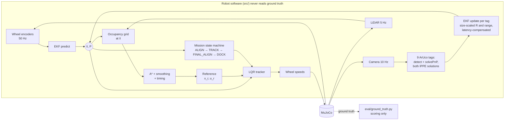

# Track A: TurtleBot3 Visual Waypoint Navigation and Docking

**UTS 41014 Sensors and Control in Mechatronics Systems: Integrated Project, Group 15**

A TurtleBot3 Waffle Pi in MuJoCo crosses a room it has never seen, builds a LiDAR map, plans around the obstacles, and docks on an ArUco-marked charging pad. It knows where it is from an **EKF that fuses wheel odometry with camera measurements of nine ArUco tags** (six on the walls, three on the dock), and it is steered by an **LQR trajectory tracker that only ever sees the EKF estimate**. Simulator ground truth is used only to score the runs.

| | |
|---|---|
| **Track** | A, mobile robot: visual waypoint navigation |
| **Team** | Group 15: *add names and student IDs* (see [Individual contributions](#individual-contributions)) |
| **Code** | <https://github.com/Rusa05/Integrated-Project---Sensors-and-Control---group15> |
| **Demo video (5 min)** | *add link* |


## Results at a glance

| What | Result | Where |
|---|---|---|
| Full mission, fixed scenarios | **9 / 9 docked**, 0.63 cm and 0.5° from the dock goal | [Part E](part_E_integration_and_robustness/) |
| Robustness: random layouts × pushes, slip, blinded camera, camera latency, 2× noise, all combined | **70 / 70 docked**, worst 0.91 cm; a push throws the estimate under 3 cm off | [Part E](part_E_integration_and_robustness/) |
| EKF vs wheel odometry alone (20 Monte Carlo runs) | **2.4 cm vs 8.1 cm** RMS; final 0.23 cm vs 9.0 cm; truth inside 3σ 100 % of the time | [Part C](part_C_estimation/) |
| EKF consistency | Average NEES 3.3 (ideal 3; 95 % bounds 2.0–4.2) | [Part C](part_C_estimation/) |
| Path tracking around obstacles | 9 / 9 without contact; 2.2 cm RMS true cross-track error | [Part D](part_D_control/) |
| Camera calibration | Checkerboard, 56 views, 0.06 px; found a 0.6 px principal-point error in our first assumption | [Part B](part_B_sensing/) |
| Failures found and fixed | 5, each traced to sensing, estimation or planning | [Part C](part_C_estimation/), [Part E](part_E_integration_and_robustness/) |

## Contents

1. [Quick start](#quick-start)
2. [System overview](#system-overview)
3. [Part A: Modelling](#part-a-modelling)
4. [Part B: Sensing, calibration and frames](#part-b-sensing-calibration-and-frames)
5. [Part C: Estimation (EKF)](#part-c-estimation-ekf)
6. [Part D: Planning and control](#part-d-planning-and-control)
7. [Part E: Integration and robustness](#part-e-integration-and-robustness)
8. [Limitations](#limitations)
9. [Repository layout and reproducing every result](#repository-layout-and-reproducing-every-result)
10. [Individual contributions](#individual-contributions)
11. [Generative AI declaration](#generative-ai-declaration)
12. [Sources and acknowledgements](#sources-and-acknowledgements)

---

## Quick start

Python 3.10+ (developed on 3.12, MuJoCo 3.15).

```bash
git clone https://github.com/Rusa05/Integrated-Project---Sensors-and-Control---group15.git
cd Integrated-Project---Sensors-and-Control---group15
python -m pip install -r requirements.txt
```

Watch a full mission: open `part_E_integration_and_robustness/run_mission.py` in VS Code and press ▶ Run, or from the repository root:

```bash
python part_E_integration_and_robustness/run_mission.py
```

A MuJoCo window opens, the robot drives to the dock, and the window closes itself after it docks. On macOS use `mjpython` instead of `python` for anything that opens a viewer.

Other entry points (all run from the repository root):

| Command | What it does | Time |
|---|---|---|
| `python part_A_modelling/turtlebot_sim.py` | Drive the robot yourself (W/A/S/D, C = camera view) | n/a |
| `python part_E_integration_and_robustness/run_mission.py --record mission.mp4` | Record a full mission with overlays | ~1 min |
| `python part_E_integration_and_robustness/run_mission.py --scenario B_box_in_way` | Other start positions: `A_cylinder_in_way`, `B_box_in_way`, `C_far_corner`, or `--start X Y THETA` | n/a |
| `python part_E_integration_and_robustness/run_trials.py --record disturbed.mp4 --only combined --trial 7` | Record a disturbed run (push, slip, occlusion, latency) | ~1 min |
| `python part_E_integration_and_robustness/run_trials.py --trials 3` | Quick robustness batch | ~3 min |

Every result on this page has its own script; see [Reproducing every result](#repository-layout-and-reproducing-every-result).

---

## System overview



**Ground-truth rule.** The robot's software is everything in [`src/`](src/). It reads only sensor channels: encoders, rangefinders and the rendered camera image. The simulator's true pose is read in exactly one file, [`eval/ground_truth.py`](eval/ground_truth.py), which the test scripts use to place the robot, score runs and diagnose failures. You can check this with:

```bash
grep -rn "ground_truth\|qpos" src/
```

It returns nothing.

**Mission states** ([`src/mission.py`](src/mission.py)):

1. **ALIGN:** turn on the spot to the path heading.
2. **TRACK:** LQR along the A* path, replanning if the path becomes blocked.
3. **FINAL_ALIGN:** face the dock from the pre-dock pose, 0.6 m out.
4. **DOCK:** LQR along a curve that ends on the dock axis, with the two small dock tags in view all the way in.
5. **DOCKED.**

---

## Part A: Modelling

Folder: [`part_A_modelling/`](part_A_modelling/) (steps A1–A4).

### Platform

The official ROBOTIS TurtleBot3 Waffle Pi model, with real meshes, masses and limits, plus the sensors we added: camera, 72-beam LiDAR and encoders. It runs in a 4 × 4 m room with two obstacles, six wall tags and a charging station.

- Wheel radius r = 0.033 m, wheel separation b = 0.288 m, mass 1.86 kg.
- Wheel limit 7.88 rad/s, which gives 0.26 m/s.

We found and fixed three problems in the official model's contact and actuator settings. Together they made the robot slip 11 % driving straight and 24 % turning. Each fix is reproducible with `part_A_modelling/official_model_checks.py`:

| Change | Why | Straight / turn, true ÷ odometry |
|---|---|---|
| Official model | n/a | 0.888 / 0.763 |
| Chassis collision mesh → box raised 1 cm | The mesh touched the floor and carried 35 % of the weight | 0.890 / 0.765 |
| Caster contact priority | MuJoCo takes the *higher* friction of two touching surfaces, so the "frictionless" casters dragged | 0.999 / 0.998 |
| Wheel servo gain kv 0.1 → 1.0 | Wheels reached only 49–75 % of the commanded speed; the real XL430 has its own velocity loop | 0.997 / 1.000 |

### State-space model

State **x** = [x, y, θ] (pose of `base_link` in the map frame); input **u** = [v, ω].

```
ẋ = v cos θ        v = r(ω_R + ω_L)/2
ẏ = v sin θ        ω = r(ω_R − ω_L)/b
θ̇ = ω
```

**Assumptions:** flat floor, rigid body, no lateral slip. Motor dynamics are ignored, because the measured wheel time constant is 14 ms against the 20 ms control period. The model is discretised at 50 Hz with a midpoint rule; the Jacobians are in [`src/model.py`](src/model.py).

For control, the tracking error **e** (reference relative to the robot, in the robot frame) is linearised about the reference (v_r, ω_r):

```
ė = A e + B u_fb,   A = [[0, ω_r, 0], [−ω_r, 0, v_r], [0, 0, 0]],   B = −[[1,0],[0,0],[0,1]]
```

### Controllability and observability

| Question | Rank | Consequence in the design |
|---|---|---|
| Tracking error, reference moving (v_r or ω_r ≠ 0) | **3 / 3** | LQR can correct any error |
| Tracking error, reference at rest | 2 / 3 | Can't correct sideways error standing still (non-holonomic). So the robot turns on the spot *before* tracking, and docking uses a moving reference |
| Odometry only | 0 / 3 | Absolute pose unobservable: drifts forever |
| Range + bearing to one tag, even while moving | **2 / 3** | Rotating the whole path about the tag gives identical readings |
| Range + bearing + **tag yaw** | **3 / 3** (condition 2.8) | The EKF uses this pose measurement |
| **Two tags 10 cm apart**, range + bearing only | **3 / 3** (condition 40) | Why the dock has two small tags: observable without yaw. The weak direction (sideways offset paired with heading) mattered when tuning R |

The rank-2 result came back in the robustness trials as a real failure. Range + bearing updates from far away, where the yaw isn't usable, moved the estimate the wrong way. Each tag is now only fused within a size-scaled range. See [Part E](#part-e-integration-and-robustness).

---

## Part B: Sensing, calibration and frames

Folder: [`part_B_sensing/`](part_B_sensing/) (steps B1–B5).


### Tag map

The robot is given the tag positions (like surveyed printed tags) but not the obstacles.

| Tags | Size | Where | Purpose |
|---|---|---|---|
| 1–6 | 15 cm | Walls, 0.20 m high | Usable to about 3 m: a tag is in range almost everywhere |
| 0 | 10 cm | Dock, 0.25 m high | Seen on the approach |
| 7, 8 | 3 cm | Dock, camera height, 10 cm apart | Stay in view down to the docked pose; make the pose observable from range + bearing alone |

### Frames

| Transform | Value | Source |
|---|---|---|
| map → base_link (T_MB) | EKF state (x, y, θ) | estimated |
| base_link → LiDAR | (−0.035, 0, 0.120) m | robot model |
| base_link → camera | (0.086, 0, 0.107) m, looking along +x of B | robot model |
| MuJoCo camera → OpenCV optical | diag(1, −1, −1) (180° about x) | convention |
| map → tag i (T_MK_i) | Per-tag pose in [`src/config.py`](src/config.py) | known map |

### Calibration

- **Camera:** checkerboard calibration over 56 rendered views at 0.06 px reprojection error.
  - A pinhole model was chosen on **held-out** views; distortion terms only fitted noise.
  - Calibrated K: fx = fy = 529.17, cx = 319.37, cy = 239.45.
  - Our first version assumed cx = 320 (W/2). Pixel coordinates count from the centre of the first pixel, so that was a 0.07° bearing bias. The robot now uses the calibrated K.
- **Range bias:** detected corners sit slightly inside the true edge, so measured range reads long by 0.0067·r² m for the 10 cm tag (fitted over 1224 frames, subtracted). For other sizes it scales by pinhole similarity, as K·r²/k.

### Noise models and measured accuracy

| Sensor | Model | Source |
|---|---|---|
| Encoders | 4096 ticks/rev + 0.002 rad jitter | Dynamixel XL430 |
| LiDAR | σ = max(7.5 mm, 2.5 % of range), 0.12–3.5 m, 1 % dropout | LDS-01 datasheet |
| Camera | 10 Hz, 640×480, pixel noise σ = 3 grey levels | Pi Camera v2 |

- **Reference model:** fitted on the 10 cm tag (0.3–2.7 m, ±40° viewing angles). Range σ = 1.1 mm·r^3.3, bearing σ = 0.007°·r^1.1, yaw σ = 0.63°·r^2.7.
- **Other sizes, by pinhole similarity:** a tag k× bigger at k× the range covers the same pixels, so σ_s(r) = k·σ_ref(r/k).
- **Checked on the 3 cm and 15 cm tags.** The model holds, with two exceptions that change how tags are used:
  1. **Yaw collapses near 2× the reference range** (12–16° RMS): yaw is used only to 1.75×.
  2. **The 3 cm tags read a consistently biased yaw** (±0.4–5°): they contribute range and bearing only.
- **IPPE ambiguity:** both planar pose solutions are kept, and the EKF uses the one that agrees with its estimate.


---

## Part C: Estimation (EKF)

Folder: [`part_C_estimation/`](part_C_estimation/). Code: [`src/ekf.py`](src/ekf.py).

### Design and parameter values

| Item | Choice | Why |
|---|---|---|
| Predict, 50 Hz | Encoder increments through the unicycle model; Q from wheel slip, 1 % of travel | Measured drift is 0.35 %. Study A below: 1 % is the consistent choice under pushes |
| Encoder rounding in Q | **left out** | Errors on an *absolute* angle cancel between increments; including them made the filter far too pessimistic |
| Update, per visible tag | z = [range, bearing, tag yaw]; gated at χ² 99 %; falls back to range + bearing | Tag yaw only within 1.75k m and only for tags ≥ 5 cm (Part B) |
| R | Part B fits scaled by tag size, floors 2 cm / 0.5° / 2°, **× 3** | The camera's errors depend on the viewpoint and repeat frame after frame. With nine tags, R × 1 left the filter 3× over-confident (NEES 6.4); × 3 gave 3.0 with the same accuracy |
| New information only | Fuse a frame after the robot moves 2 cm or turns 2° (or after 2 s), at most 5 frames/s | Same viewpoint = same error = no new information |
| Lock-out recovery | After 5 rejections in a row, inflate P on each further rejection | Found in Part E: a bad start otherwise rejects every reading |
| Latency compensation | Rewind 1 s of history to the frame's capture time, update, replay odometry | Found in Part E: 0.2 s latency otherwise "docked" up to 44 cm off |

### Results (20 Monte Carlo runs)

| | EKF | Odometry only |
|---|---|---|
| Position RMSE | **2.4 cm** | 8.1 cm |
| Heading RMSE | **0.79°** | 2.6° |
| Final position error | **0.23 cm** | 9.0 cm |
| Truth inside ±3σ | **100 %** | n/a |
| Average NEES (ideal 3, bounds 2.0–4.2) | **3.3** | n/a |


### Studies

**What if R were 10× smaller or larger?**

| R scale | Position RMSE | NEES |
|---|---|---|
| ×0.1 | 2.04 cm | **19.6**: badly over-confident; the gate rejects good readings |
| **×1** | **2.12 cm** | **3.4**: consistent |
| ×10 | 2.38 cm | 1.2: pessimistic, slow to correct |

**Study A: consistency against responsiveness.** Q scaled ×0.3 to ×10, robot pushed, 6 random layouts each:

- Mean NEES runs 4.3 / **3.2** / 2.0 / 1.3 across the four scales, so the chosen Q is the consistent one.
- Accuracy is the same at every scale, because with tags almost everywhere the next frame corrects a push before the error reaches 3 cm.

**Study D: which measurements matter.**

| Measurements | Docked | EKF RMSE | Dock error (worst) |
|---|---|---|---|
| **Range + bearing + tag yaw** | **6 / 6** | **1.47 cm** | **0.53 cm (0.68)** |
| Range + bearing only | 6 / 6 | 1.68 cm | 0.67 cm (1.52) |
| Odometry only | **0 / 6** | 7.58 cm | 8.08 cm (13.5) |

The camera is essential. Tag yaw helps here because often only one or two tags are in view at a time; with several tags always visible, range and bearing alone would be enough.

---

## Part D: Planning and control

Folder: [`part_D_control/`](part_D_control/). Code: [`src/mapping.py`](src/mapping.py), [`src/planner.py`](src/planner.py), [`src/controller.py`](src/controller.py).

### Design

- **Map:** log-odds occupancy grid, 5 cm cells, built online from LiDAR at the EKF pose. The obstacles are never given to the robot.
- **Planner:** A* with **0.25 m inflation**, which is the circle containing the Waffle Pi footprint around its axle, plus a 0.2 m soft margin. Then line-of-sight shortcuts and smoothing.
- **Timing:** cruise 0.18 m/s, lateral acceleration ≤ 0.15 m/s², acceleration ≤ 0.2 m/s². Heading and curvature come from a 41 cm Savitzky-Golay derivative, which removed a grid-induced turn-rate wobble.
- **LQR:** discrete LQR on the linearised tracking error, gain-scheduled on reference speed, u = [v_r cos e₃, ω_r] − K e, with curvature-preserving wheel saturation.
- **LQR weights by Bryson's rule:** Q = diag(1/0.05², 1/0.05², 1/0.15²), R = diag(1/0.10², 1/0.8²).
- **At standstill** (v_r = ω_r = 0) the error is uncontrollable (rank 2), so the robot turns on the spot first.
- **Docking:**
  - Turn to face the dock 0.6 m out, then follow a 0.32 m cubic Hermite curve ending on the dock axis at 0.06 m/s, with the same LQR.
  - The two small dock tags stay in view all the way in.
  - LiDAR backstop: the robot stops if the backplate reads under 0.27 m (0.325 m expected at the dock).

### Results

| Test | Result |
|---|---|
| Navigate to pre-dock, 3 scenarios × 3 seeds | 9 / 9, no contact; final 0.86 cm / 0.9° |
| Cross-track error vs **estimate** (controller's view) | 0.8 cm RMS |
| Cross-track error vs **truth** | **2.2 cm RMS** (4.7 cm with the single dock marker; the wall tags halved it) |
| Full mission with docking, 9 runs | **9 / 9 docked, 0.63 cm, 0.5°** (2 cm / 3° tolerance) |


**Control effort against tracking error** (LQR R ×0.1 / ×1 / ×10):

| R scale | Feedback turn effort | Cross-track error vs truth |
|---|---|---|
| ×0.1 | 0.104 rad/s | 0.85 cm |
| **×1** | **0.069 rad/s** | **0.97 cm** |
| ×10 | 0.040 rad/s | 1.16 cm |

- With the single marker this curve was flat, because estimation error swamped control.
- With the wall tags halving that error, a real trade-off appears: +51 % effort buys −12 % error, and −42 % effort costs +20 %.

---

## Part E: Integration and robustness

Folder: [`part_E_integration_and_robustness/`](part_E_integration_and_robustness/) (E1 full mission, E2 trials).

### Trials

Every trial has a random start pose, random obstacle positions and rotation, and a random initial-estimate error. Ten per condition.

| Condition | Docked (2 cm / 3°) | Dock error mean / worst | Worst EKF error in run (median) |
|---|---|---|---|
| Nominal | **10 / 10** | 0.52 / 0.68 cm | 3.5 cm |
| Push: 8 N for 0.2 s, random time and direction | **10 / 10** | 0.56 / 0.65 cm | 2.8 cm |
| Slip: tyre friction 1.0 → 0.1 | **10 / 10** | 0.51 / 0.69 cm | 3.9 cm |
| Camera blinded for 10 s | **10 / 10** | 0.55 / 0.74 cm | 4.8 cm |
| Camera latency 0.2 s | **10 / 10** | 0.50 / 0.62 cm | 8.8 cm |
| Latency 0.2 s, compensation off | 9 / 10 | 0.80 / 1.62 cm | 9.2 cm |
| All sensor noise ×2 | **10 / 10** | 0.57 / 0.77 cm | 5.7 cm |
| Combined: push + slip + blinded + 0.1 s latency | **10 / 10** | 0.59 / 0.91 cm | 6.1 cm |


### Failures diagnosed and fixed

Classified automatically, then replayed with a full filter log.

| Failure | Root cause | Part | Fix |
|---|---|---|---|
| Latency: "docked" 6–44 cm off, confident | Measurements fused as if current; 0.2 s ≈ 9° at 0.8 rad/s | Estimation | Timestamped frames; EKF rewinds and replays (unit-tested exact) |
| Noise ×2: 16 cm off | Far range + bearing updates *increased* the error: one tag can't fix heading (rank 2) | Estimation | Size-scaled range limit per tag |
| Occlusion: 49 cm off | **Gate lock-out:** a bad start made every reading fail the gate | Estimation | Inflate P after 5 rejections in a row |
| Right place, 3.5–8.6° crooked | Docking path was a straight line from wherever the robot stopped | Planning | Hermite curve ending on the dock axis |
| Multi-tag filter 3× over-confident (NEES 6.4) | Biased small-tag yaw; viewpoint errors repeating; clustered dock tags | Sensing / estimation | Small tags: range + bearing only; fuse only after moving; R × 3 (NEES 3.0) |

**Single marker against multi-tag:**

- Both docked every trial in the seven real conditions.
- The tags cut the median worst-case EKF error from 7.6–10.5 cm to 2.8–6.1 cm.
- A push now moves the estimate under 3 cm, against 5–35 cm before.
- Without latency compensation, latency is the only condition that still fails.

---

## Limitations

What these results do and don't support:

- **Sample size.** 10/10 per condition bounds the true success rate above about 69 % (95 % confidence) per condition; 70/70 in the seven real conditions, above about 95 %.
- **Simulation only.** The camera has no lens distortion, blur or rolling shutter, and its bearing noise is unrealistically small. That is why R has floors, and why the R × 3 correction was tuned on consistency, not taken from a datasheet. On hardware, R would need re-measuring.
- **R × 3 is an empirical correction** for errors that repeat across frames. Modelling them directly, for example with a per-tag bias state, would be the principled next step.
- **Known tag map.** The tag poses are given; an error in them would bias the estimate. The obstacles are mapped online.
- **Static world.** The replanning and LiDAR safety stop were implemented but never triggered in 80 trials.
- **No global re-localisation.** Pushes up to 8 N are recovered by the next camera frame. A large "kidnap" would need a step that re-localises from the tags alone, without trusting the current estimate, and that isn't implemented.

---

## Repository layout and reproducing every result

The repository is organised by the marking guide's parts. Each part folder has a README that opens with what the guide asks for, then the steps in order, the design choices with their values, and the results.

| Folder | Marking part | Steps | Reproduce with | Time |
|---|---|---|---|---|
| [`part_A_modelling/`](part_A_modelling/) | **A** Modelling | A1 drive the robot · A2 open-loop test · A3 official-model fixes · A4 controllability/observability (incl. two-tag case), actuator, odometry | `python part_A_modelling/official_model_checks.py`<br>`python part_A_modelling/model_analysis.py` | 40 s |
| [`part_B_sensing/`](part_B_sensing/) | **B** Sensing | B1 tag map · B2 detection check · B3 frame diagram · B4 noise model · B5 checkerboard calibration | `python part_B_sensing/make_aruco.py`<br>`python part_B_sensing/check_dock_marker.py`<br>`python part_B_sensing/sensor_noise.py`<br>`python part_B_sensing/calibrate_camera.py` | 2 min |
| [`part_C_estimation/`](part_C_estimation/) | **C** Estimation | C1 EKF Monte Carlo, NEES/NIS, R study · C2 Q-scale and measurement-ablation studies | `python part_C_estimation/run_ekf_test.py`<br>`python part_C_estimation/tradeoff_studies.py` | 6 + 3 min |
| [`part_D_control/`](part_D_control/) | **D** Control | D1 navigation + LQR trade-off · D2 docking controller | `python part_D_control/run_navigation.py` | 4 min |
| [`part_E_integration_and_robustness/`](part_E_integration_and_robustness/) | **E** Integration and robustness | E1 full mission + video · E2 80 disturbed trials | `python part_E_integration_and_robustness/run_mission.py --batch`<br>`python part_E_integration_and_robustness/run_trials.py` | 3 + 5 min |
| [`deliverables/`](deliverables/) | Section 3 checklist | Submission checklist, 5-minute video plan | n/a | n/a |

Shared code, used by every part:

| Folder | Contents |
|---|---|
| [`src/`](src/) | The robot's software: `model`, `sensors`, `vision`, `ekf`, `mapping`, `planner`, `controller`, `mission`, `robot`, `config`. **Never reads ground truth** |
| [`eval/`](eval/) | `ground_truth.py`: the only file that reads the true pose (scoring only) |
| [`turtlebot3/`](turtlebot3/) | MuJoCo world and robot (official ROBOTIS model + Track A changes) |

Random seeds are fixed, so each script reproduces the numbers on this page.

---

## Individual contributions

> *To be completed by the team. Each member writes their own row: what they designed, implemented, tested and wrote, with the files and parts. Viva questions cover your own part and at least one part you didn't lead.*

| Member (student ID) | Main contributions | Files / phases |
|---|---|---|
| *name (ID)* | | |
| *name (ID)* | | |
| *name (ID)* | | |
| *name (ID)* | | |

---

## Generative AI declaration

> *Review and edit so it matches how each member actually used these tools.*

| Tool | Used for |
|---|---|
| **ChatGPT** (OpenAI) | Setup troubleshooting, early project planning, and adapting the initial movement-test script (`part_A_modelling/open_loop_test.py`) |
| **Codex** (OpenAI) | Generating the original primitive-shape starter robot and the keyboard-driving script (`part_A_modelling/turtlebot_sim.py`, since adapted to the Waffle Pi) |
| **Claude** (Anthropic, via Claude Code) | Project planning document; writing and debugging code for Parts A–E (tag map and scene, model checks, sensor noise, camera calibration, vision, EKF, mapping, planner, LQR, mission, trials, video recorder); diagnosing the official model's slip, the robustness-trial failures and the multi-tag over-confidence; drafting READMEs and this page |

All results on this page come from running the code in this repository. The team is responsible for checking, understanding and being able to explain every part of it in the viva.

---

## Sources and acknowledgements

- **Robot model:** [ROBOTIS mujoco menagerie](https://github.com/ROBOTIS-GIT/robotis_mujoco_menagerie), TurtleBot3 Waffle Pi, Apache-2.0 ([`turtlebot3/LICENSE_ROBOTIS.txt`](turtlebot3/LICENSE_ROBOTIS.txt)). The unmodified file is kept as `turtlebot3/turtlebot3_waffle_pi_official.xml`; our changes are marked `TRACK A` in `turtlebot3/turtlebot3_waffle_pi_track_a.xml`.
- **Simulation loop:** structure adapted from the supplied UR3 tutorial (`move_ur3e.py`).
- **Libraries:** [MuJoCo](https://mujoco.org), [OpenCV](https://opencv.org) (ArUco detection, IPPE solvePnP), NumPy, SciPy (Riccati solver, distance transform, Savitzky-Golay), Matplotlib.
- **Hardware figures:** ROBOTIS LDS-01 and Dynamixel XL430 datasheets; Raspberry Pi Camera v2 field of view.
- **Methods:**
  - EKF consistency tests (NEES/NIS): Bar-Shalom, Li and Kirubarajan, *Estimation with Applications to Tracking and Navigation* (2001).
  - Tracking-error model: Kanayama et al., "A stable tracking control method for an autonomous mobile robot" (ICRA 1990).
  - LQR weights by Bryson's rule.
  - IPPE planar pose and its two-fold ambiguity: Collins and Bartoli, "Infinitesimal Plane-Based Pose Estimation" (IJCV 2014).
