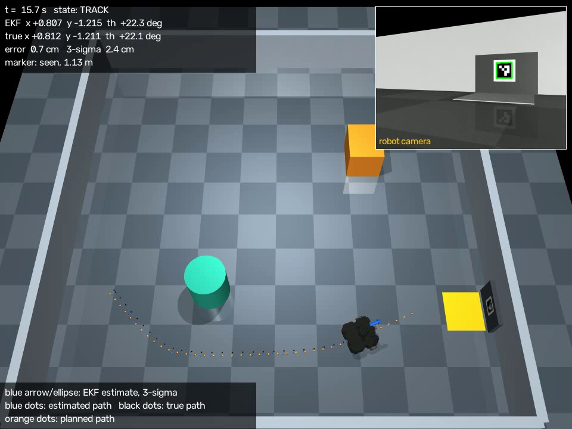
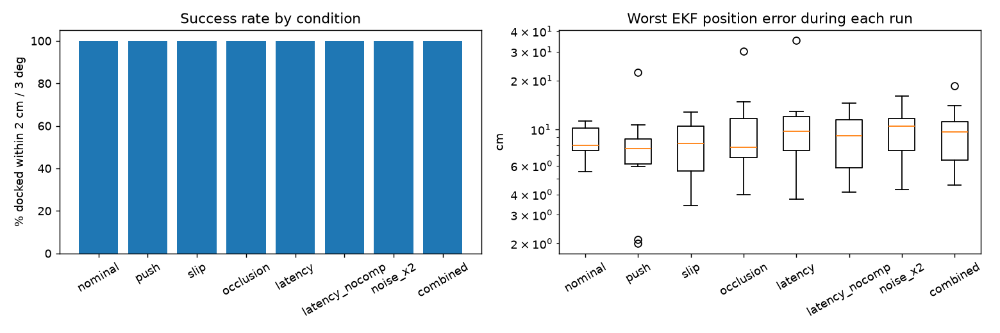
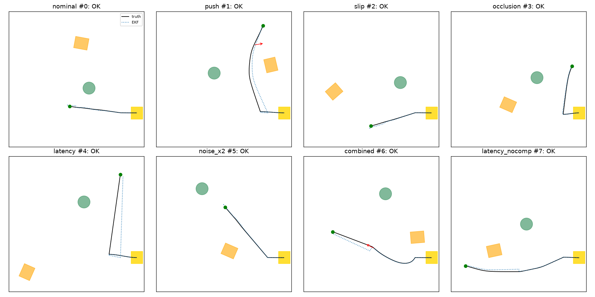

# Part E: Integration and robustness

> **Marking guide, Part E (20 marks):** "performance under disturbance and noise".
> Distinction band: "performance is reported over repeated trials with varied conditions, and failures are diagnosed and traced to specific causes in the model, sensing, estimator or controller".

This part covers the complete pipeline in one run (start → navigate → dock), the video recorder, and 80 randomised trials under disturbances, with every failure traced to its cause.

## Steps, in order

| Step | Script | What it does | Time |
|---|---|---|---|
| E1 | `run_mission.py` | Watch one mission live in MuJoCo (also what VS Code's ▶ Run button does) | 35 s |
| E1 | `run_mission.py --batch` | Full mission, 3 scenarios × 3 seeds, headless; saves `results/mission/` | 3 min |
| E1 | `run_mission.py --record mission.mp4` | Record one mission with overlays (demo video) | 1 min |
| E2 | `run_trials.py` | 8 conditions × 10 random trials, 4 processes | 5 min |
| E2 | `run_trials.py --record run.mp4 --only combined --trial 7` | Record one disturbed trial | 1 min |
| E2 | `run_trials.py --report-only` | Redraw the plots from saved results | 5 s |

Run from the project root, for example `python part_E_integration_and_robustness/run_mission.py`, or open the file in VS Code and press ▶ Run.

- `run_mission.py` options: `--scenario A_cylinder_in_way | B_box_in_way | C_far_corner`, `--seed N`, `--start X Y THETA`.
- `run_trials.py` options: `--trials N`, `--only CONDITION`.
- On macOS use `mjpython` for the live viewer.

Results: `results/mission/` (E1) and `results/trials/` (E2).

---

## How the pieces fit

- [`src/robot.py`](../src/robot.py) is the robot's hardware interface. It samples encoders every 20 ms, LiDAR at 5 Hz and the camera at 10 Hz, timestamps each camera frame, and sends wheel speeds. It never reads the true pose.
- [`src/mission.py`](../src/mission.py) runs the EKF ([Part C](../part_C_estimation/)), the map, planner and LQR ([Part D](../part_D_control/)), and the state machine ALIGN → TRACK → FINAL_ALIGN → DOCK → DOCKED.
- Ground truth is read only in [`eval/ground_truth.py`](../eval/ground_truth.py), to place the robot, score runs, detect collisions and diagnose failures.

## E1. Full mission (`results/mission/`)

| Metric | 9 runs (3 scenarios × 3 seeds) |
|---|---|
| Docked within 2 cm and 3°, no collisions | **9 / 9** |
| Final position error (truth vs dock goal) | **0.63 cm mean**, 0.79 cm worst |
| Lateral / depth error | −0.2 to +0.4 cm / −0.29 to −0.67 cm (always slightly short) |
| Final heading error | **0.52° mean**, 0.82° worst |
| EKF error at the dock | 0.20–0.57 cm, against a 3σ of about 1.0 cm (consistent) |
| Dock tags in view at the docked pose | **Yes, every run** (0.30 m away) |
| Mission time | 30.6 s mean |

- **Always slightly short:** docking stops once the estimate is within 1 cm of the goal, approaching from in front.
- **Accurate, and honest about it:** the dock tags are in view all the way in, so the estimate is corrected right to the end. With the single marker, the last 17 cm were blind.

**Video overlays** (the brief asks for "the estimate and its uncertainty alongside the true state"):

| On screen | Meaning |
|---|---|
| Blue arrow + ellipse | EKF estimate and its 3σ position uncertainty |
| Blue / black dots | Estimated / true path so far |
| Orange dots | Current planned path |
| Top-left panel | State, EKF pose, true pose, error, 3σ, tags in view with their ranges |
| Top-right inset | The robot's camera, every detected tag outlined in green (greyed out while the camera is blinded) |
| Banner (trials only) | Active disturbances: push, blinded camera, latency, slip |

Recorded examples:

- `results/mission/mission_A.mp4`: nominal; docks at 0.47 cm.
- `results/trials/combined_trial7.mp4`: pushed at 8 s, slippery tyres, 0.1 s latency, camera blinded for 10 s during the approach. Docks at **0.33 cm**; the push only moved the estimate 4.6 cm off.

## E2. Robustness trials (`results/trials/`)

**Every trial** gets:

- a random start pose (anywhere with clearance, any heading);
- random positions for the box (and its rotation) and the cylinder;
- a random initial-estimate error drawn from P0.

Trial *n* uses the same layout in every condition, so conditions compare like for like. The robot's code never knows which condition it's in.

| Condition | What changes | Where it acts |
|---|---|---|
| nominal | nothing else | n/a |
| push | 8 N sideways shove for 0.2 s at a random time (6–20 s), random direction | world |
| slip | tyre friction 1.0 → 0.1 | world |
| occlusion | camera sees **no tags** for a random 10 s window (blocked or blinded) | sensor ([`src/robot.py`](../src/robot.py)) |
| latency | each frame's tag measurements delivered 0.2 s late | sensor |
| latency_nocomp | the same, with the EKF's latency compensation off | for comparison |
| noise_x2 | every sensor's noise doubled | sensor |
| combined | push + slip + occlusion + 0.1 s latency | both |

### Results: final code (multi-tag), 80 trials

| Condition | Docked (2 cm / 3°) | Dock error mean / worst | Worst EKF error during run (median) |
|---|---|---|---|
| nominal | **10 / 10** | 0.52 / 0.68 cm | 3.5 cm |
| push | **10 / 10** | 0.56 / 0.65 cm | 2.8 cm |
| slip | **10 / 10** | 0.51 / 0.69 cm | 3.9 cm |
| occlusion (camera blinded 10 s) | **10 / 10** | 0.55 / 0.74 cm | 4.8 cm |
| latency 0.2 s | **10 / 10** | 0.50 / 0.62 cm | 8.8 cm |
| latency 0.2 s, **no compensation** | 9 / 10 | 0.80 / **1.62** cm | 9.2 cm |
| noise ×2 | **10 / 10** | 0.57 / 0.77 cm | 5.7 cm |
| combined | **10 / 10** | 0.59 / 0.91 cm | 6.1 cm |

**70 / 70** in the seven real conditions, no collisions, about 27 s per mission.

| | Single dock marker (before) | Multi-tag (now) |
|---|---|---|
| Docked, seven real conditions | 70 / 70 | 70 / 70 |
| Worst EKF error during a run (median per condition) | 7.6–10.5 cm | **2.8–6.1 cm** (latency 8.8) |
| Push: how far the estimate is thrown off | 5–35 cm, until the marker came back into view | **Under 3 cm**: the next frame corrects it |

### Failures found, diagnosed and fixed

Failures are classified automatically (`run_trial` in `run_trials.py`):

- **Collision:** was the EKF more than 8 cm off at the moment of contact?
- **Docking miss:** was the EKF's position or heading off at the dock?

Failing runs were then replayed with a full filter log.

**With the single dock marker**, the first full batch docked 59 / 70, and 1 / 10 with uncompensated latency. Four causes:

| # | Symptom | Diagnosis | Part | Fix |
|---|---|---|---|---|
| 1 | Latency: "docked" 6–44 cm from the pad, confident it was right (9 / 10 failed) | Measurements fused as if they described the robot now; they described it 0.2 s earlier (about 9° of heading at 0.8 rad/s) | **Estimation** | **Latency compensation:** timestamped frames; the EKF rewinds 1 s of history to the capture time, updates there, replays odometry. Unit-tested to match exactly |
| 2 | Noise ×2: docked 16 cm off | Three range + bearing updates at 2.6–2.8 m were accepted and each made the error worse (5 → 19 cm). Without the yaw, one tag can't fix heading: rank 2, [Part A](../part_A_modelling/) | **Estimation** (observability) | Range limit per tag (now scaled by tag size) |
| 3 | Occlusion, noise ×2: EKF 17–49 cm off but rejecting every reading | **Gate lock-out:** a bad start made every reading fail the χ² gate; the error grew while the filter still claimed ±15 cm | **Estimation** (consistency) | After 5 rejections in a row, inflate P on each further rejection |
| 4 | Six runs on one layout: right place, 3.5–8.6° crooked | The EKF heading was right; the docking path was a straight line from wherever the robot stopped | **Planning** | Hermite curve ending on the dock axis |

**The multi-tag upgrade** introduced one more problem, found by consistency testing rather than by a failed dock: the filter became about 3× over-confident (NEES 6.4). It was traced to:

- biased small-tag yaw;
- viewpoint errors repeating frame after frame;
- the clustered dock tags.

It was fixed in [Part C](../part_C_estimation/), giving NEES 3.0.

**Is latency compensation still needed?** Yes. Without it, latency is the only condition that still fails (1 / 10, EKF 2.5 cm off at the dock), and its mean and worst dock errors are 1.6× and 2.6× those with compensation. The other safeguards limit the damage; compensation removes the cause.

## Limitations

- **Sample size:** 10/10 per condition bounds the true success rate above about 69 % (95 % confidence); 70/70 over the seven real conditions, above about 95 %.
- **Static obstacles:** the replanning and safety stop were never needed in 80 runs.
- **Disturbance size:** pushes are limited to 8 N for 0.2 s. A large "kidnap" would need a global re-localisation step: starting from the tags alone, without trusting the current estimate. That isn't implemented yet.
